# Lab 06: Building Tool-Using AI Agents with Ollama, Persistent Memory, RAG & n8n Automation

**Module:** PUSL 3205 — Large Language Models and Generative AI  
**Environment:** Windows 11 | Python 3.12 (`rag_env`) | Ollama (`llama3.2:3b`, `qwen3-embedding:0.6b`) | LangChain | ChromaDB | SQLite | Docker & n8n  

---

## 📑 Table of Contents
1. [Executive Summary & Objectives](#-1-executive-summary--objectives)
2. [Repository & Branch Architecture](#-2-repository--branch-architecture)
3. [Environment Setup & Model Verification](#-3-environment-setup--model-verification)
4. [Part A: GUI-Automating Calculator Agent (`agent.py`)](#-4-part-a-gui-automating-calculator-agent-agentpy)
5. [Part A (Exercise): Expanded Multi-Tool OS Agent (`expanded_agent.py`)](#-5-part-a-exercise-expanded-multi-tool-os-agent-expanded_agentpy)
6. [Part B: Short-Term & Long-Term SQLite Memory Agent (`mem_rag_agent.py`)](#-6-part-b-short-term--long-term-sqlite-memory-agent-mem_rag_agentpy)
7. [Part C: Hybrid RAG + Memory + Tool Agent (`rag_agent.py`)](#-7-part-c-hybrid-rag--memory--tool-agent-rag_agentpy)
8. [Part D: Google Cloud & OAuth 2.0 Calendar API Integration](#-8-part-d-google-cloud--oauth-20-calendar-api-integration)
9. [Part E: Dockerized n8n Local AI Agent Workflow](#-9-part-e-dockerized-n8n-local-ai-agent-workflow)
10. [Engineering Challenges, Debugging & Solutions](#-10-engineering-challenges-debugging--solutions)
11. [Conclusion & Architectural Reflection](#-11-conclusion--architectural-reflection)

---

## 🎯 1. Executive Summary & Objectives

Whilst most large language models are static and cannot access or engage directly with operating systems, APIs or other data sources, this laboratory utilised LangChain and n8n to develop self-operating AI agents that can utilise tools and operate fully on-device using the **Ollama** platform (llama3.2:3b).

The laboratory then illustrates how to:
* Attach specific Python tools to our on-device LLM, adhering to defined tool-calling syntaxes (llm.bind_tools()).
*Control native Windows programmes (calc.exe, notepad.exe) and manipulate files using a range of Python libraries, including: pyautogui, pygetwindow, subprocess and glob.
* Develop a two-part agent memory system – both transient in-memory conversational memory and long-term SQLite database (student_memory.db) memory.
*Anchor an agent’s outputs in organisational information by utilising Retrieval-Augmented Generation (RAG) with the aid of ChromaDB and qwen3-embedding:0.6b, applied to the MOHE Computing Award Handbook.
* Establish easy-to-use agent processes using n8n and Docker. These facilitate linkage between on-device Ollama models and external cloud API services (including Google Calendar API accessed by OAuth 2.0).

---

## 🗂️ 2. Repository & Branch Architecture

This lab is maintained in a dedicated Git branch (`Lab-06-AI-Agents`) structured for reproducibility, clean version control, and security compliance.

```text
Lab 06 - Tool-Using AI Agents & n8n Automation/
├── README.md                                  # Complete laboratory documentation & execution evidence
├── .gitignore                                 # Excludes virtual envs, vector stores, runtime DBs, & OAuth secrets
├── agent.py                                   # Part A: Single-tool Windows Calculator GUI agent
├── expanded_agent.py                          # Part A (Exercise): 6-tool desktop & file-system agent
├── mem_rag_agent.py                           # Part B: SQLite persistent memory + Calculator agent
├── rag_agent.py                               # Part C: Unified RAG (ChromaDB) + SQLite Memory + Calculator agent
├── data/
│   └── COMPUTING AWARD HANDBOOK_MOHE (2).pdf  # Institutional knowledge base ingested for RAG
└── screenshots/                               # Full visual execution evidence (Parts A through E)
    ├── Ollama_setup_success.png
    ├── calculater_agent.png
    ├── create_hellostudent_textdoc.png
    ├── Create_text_fileUsing.png
    ├── reg_output_asking_my _name.png
    ├── reg_with_memory_retrive_name.png
    ├── google_console_for_create_api.png
    ├── api_setup_for_calender.png
    ├── docker_destop_with_project_run.png
    ├── Ai_agent.png
    ├── Ai_agent_Successfully_work_with_calculater.png
    └── Ai_agent_Work_Google_calender_success.png
```

> **Security & Hygiene Note:** Local runtime artifacts (`chroma_db/`, `student_memory.db`, `test.txt`), Python environments (`rag_env/`), and Google Cloud OAuth secret JSON files are excluded from Git commits via `.gitignore`.

---

## ⚙️ 3. Environment Setup & Model Verification

Agents were created after setting up the environment using the following tools; LangChain, ChromaDB, PDF parser and Windows GUI automation:

```powershell
# Install required libraries
pip install langchain langchain-ollama langchain-chroma langchain-community pypdf pyautogui pygetwindow

# Verify locally pulled Ollama models
ollama list
```

### Verified Local Models
llama3.2:3b (2.0 GB) – Used as ‘think’ and tool calling LLM. Deterministic JSON based tool arguments are created by setting temperature to 0.

qwen3-embedding:0.6b (639MB) – This is a dense vector model which is used on PDF sections in Part C.

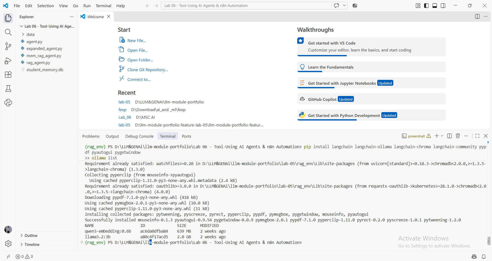

---

## 🧮 4. Part A: GUI-Automating Calculator Agent (`agent.py`)

### Architecture & Implementation Details
In `agent.py`, rather than allowing the LLM to perform error-prone mental arithmetic, the model is forced via system instructions and tool-binding to delegate all mathematical queries to the native Windows Calculator (`calc.exe`).

1. **Tool Definition (`@tool`):** `open_calculator(expression: str)` launches `calc.exe` via `subprocess.Popen("calc.exe")`, locates the active window using `gw.getWindowsWithTitle("Calculator")`, clears previous state (`pyautogui.press("esc")`), types the expression (`pyautogui.write(expression, interval=0.1)`), and triggers evaluation (`enter`).
2. **Agent Reasoning Loop (`run_agent()`):**
   * User input is wrapped in a `HumanMessage` alongside a strict `SystemMessage`.
   * `llm_with_tools.invoke(messages)` inspects whether a tool call is required.
   * When `ai_msg.tool_calls` is populated, Python dispatches the arguments to `tool_map["open_calculator"]`, captures the execution string in a `ToolMessage`, and sends the updated conversation history back to the LLM to synthesize the final natural-language answer.

### Execution & Evidence
* **User Query:** `600+678`
* **Tool Dispatched:** `open_calculator` with arguments `{'expression': '600+678'}`
* **Observed Behavior:** Windows Calculator opened automatically, entered `600 + 678`, computed `1,278`, and the agent confirmed: *"The result of the calculation is: 1278"*.

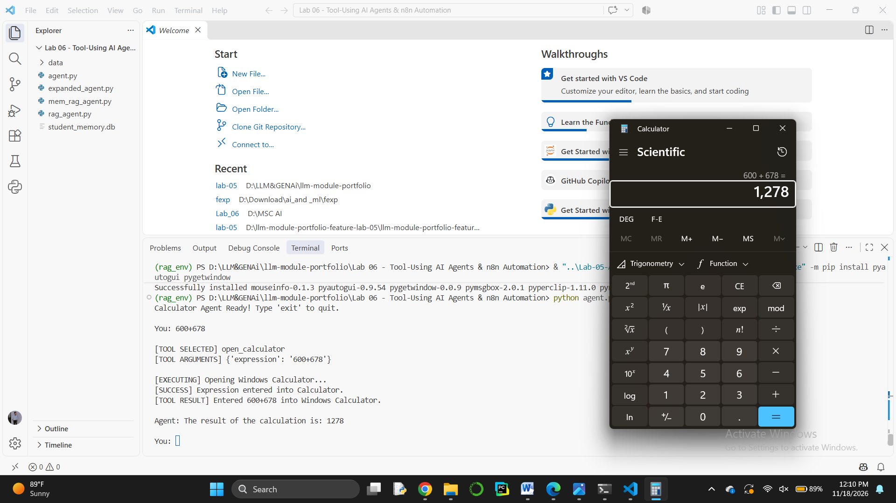

---

## 🛠️ 5. Part A (Exercise): Expanded Multi-Tool OS Agent (`expanded_agent.py`)

### Architecture & Tool Capabilities
`expanded_agent.py` scales the agent's action space from a single tool to **six heterogeneous operating system and file-management tools** bound simultaneously to `llama3.2:3b`:

| # | Tool Name | Python Modules | Functional Description |
| :- | :--- | :--- | :--- |
| 1 | `open_calculator` | `subprocess`, `pyautogui`, `pygetwindow` | Launches Windows Calculator and executes arithmetic expressions. |
| 2 | `get_date_time` | `datetime` | Retrieves real-time local system date and timestamp (`%Y-%m-%d %H:%M:%S`). |
| 3 | `open_notepad_and_write` | `subprocess`, `pyautogui`, `pygetwindow` | Spawns `notepad.exe`, focuses the editor window, and types user text. |
| 4 | `search_files` | `os`, `glob` | Recursively scans a target directory for files matching a given extension (`**/*.pdf`). |
| 5 | `create_text_file` | Built-in `open()` | Creates or overwrites a UTF-8 text file at a specified path with custom content. |
| 6 | `get_system_info` | `platform` | Inspects host OS release, Windows build version, machine node name, and CPU architecture. |

### Execution & Evidence

#### 1. Date/Time Retrieval & Windows Notepad GUI Automation
* **Queries Tested:** `"What is the date today?"` followed by `"Open Notepad and write Hello Students"`.
* **Observed Behavior:** The agent first invoked `get_date_time` (returning `2026-11-18 12:13:53`), then selected `open_notepad_and_write` (`{'text': 'Hello Students'}`), launching Notepad and typing `"Hello Students"` directly into the window.

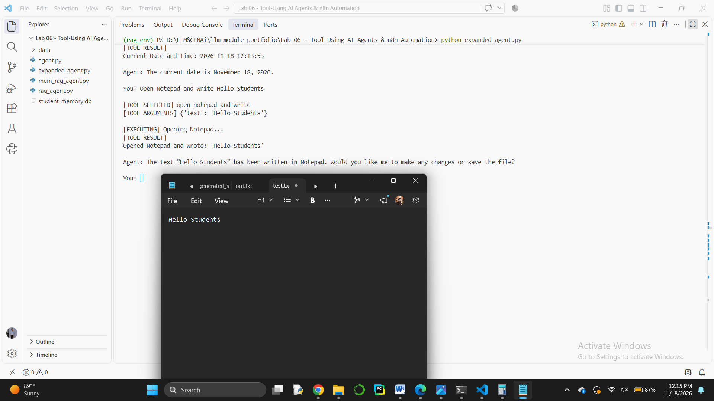

#### 2. Programmatic File System Creation
* **Query Tested:** `Create a text file at path "test.txt" with content "Hello World"`
* **Observed Behavior:** The agent selected `create_text_file` with cleanly separated arguments (`{'content': 'Hello World', 'filepath': 'test.txt'}`) and generated `test.txt` on disk.

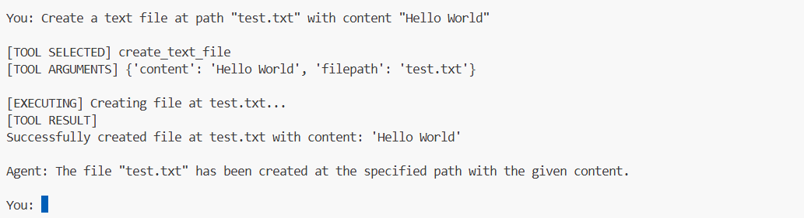

---

## 🧠 6. Part B: Short-Term & Long-Term SQLite Memory Agent (`mem_rag_agent.py`)

### Dual-Layer Memory Design
Stateless agents forget user identity once a terminal session ends. `mem_rag_agent.py` solves this by combining:
* **Short-Term Working Memory:** Maintained in-memory via the `messages` list during an active conversation turn.
* **Long-Term Persistent Memory (`student_memory.db`):** Backed by a local SQLite relational database initialized via `init_db()` with schema:
  ```sql
  CREATE TABLE IF NOT EXISTS memories (
      id INTEGER PRIMARY KEY AUTOINCREMENT,
      query TEXT,
      response TEXT
  );
  ```

### Memory Lifecycle (Write & Read)
1. **Automatic Fact Extraction & Storage (`save_memory`):** After each turn, the loop inspects user input for self-introduction patterns (`"my name is"`, `"i'm"`, `"i am"`, `"im "`). When detected, the user statement and agent greeting are committed to `student_memory.db`.
2. **Semantic/SQL Retrieval Tool (`search_student_memory`):** Registered as a LangChain `@tool`. When a user asks an identity or recall question, the LLM invokes `search_student_memory`, which queries SQLite (`SELECT query, response FROM memories`) and injects stored records back into the LLM context.

### Execution & Evidence

#### Step 1: Initial Session & Memory Persistence
* **Query:** `"Hi i am Akshan"`
* **Observed Behavior:** The agent greeted the user and logged `[SAVED] Stored new information to SQLite memory.`


#### Step 2: Cross-Session Memory Retrieval
* **Query:** `"What is my name?"`
* **Observed Behavior:** The agent triggered `[TOOL SELECTED] search_student_memory`, retrieved `User Statement: Hi i am Akshan` from `student_memory.db`, and accurately answered with the user's name.

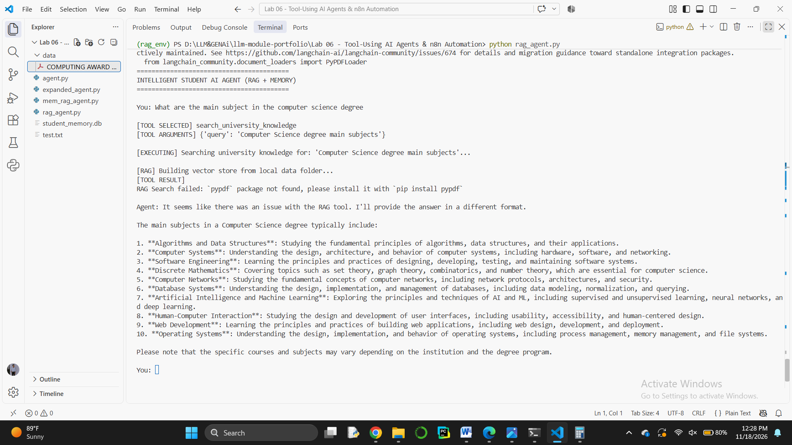

---

## 📚 7. Part C: Hybrid RAG + Memory + Tool Agent (`rag_agent.py`)

### Unified Three-Tool Architecture
`rag_agent.py` integrates deterministic GUI execution, SQLite user memory, and dense vector document retrieval into a single unified agent:
1. `open_calculator` — Desktop GUI arithmetic.
2. `search_student_memory` — Persistent SQLite user profile lookup.
3. `search_university_knowledge` — Vector similarity search over institutional PDF documents.

### Vector Store Pipeline (`get_vectorstore()`)
* **Document Ingestion:** Scans `data/` for PDF files (`COMPUTING AWARD HANDBOOK_MOHE (2).pdf`) using `PyPDFLoader`.
* **Chunking Strategy:** Splits extracted pages using `RecursiveCharacterTextSplitter(chunk_size=500, chunk_overlap=50)` to preserve course table boundaries and module codes.
* **Embedding & Persistence:** Embeds chunks using `OllamaEmbeddings(model="qwen3-embedding:0.6b")` and persists them in `Chroma` (`CHROMA_DIR`). Subsequent runs load the persisted vector store immediately without re-indexing.
* **Source Citation:** When queried about degree subjects or policies, `search_university_knowledge` retrieves the top $k=2$ most relevant chunks and returns both the exact text and metadata (`Source` and `Page` number).

---

## ☁️ 8. Part D: Google Cloud & OAuth 2.0 Calendar API Integration

To allow an external agentic workflow to read schedules and book events on a real user calendar, secure API authentication was configured in **Google Cloud Platform (GCP)**:

1. **Project Creation:** Created a dedicated GCP project named **`University AI assistant`** (`Project ID: charged-thought-514705-d2`).

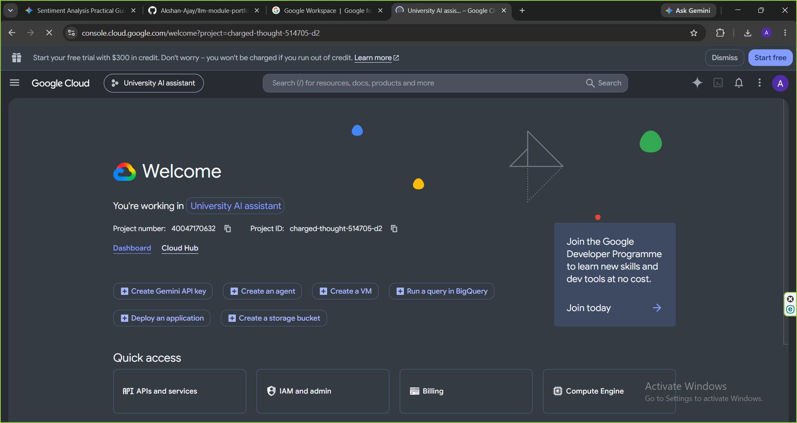

2. **API Enablement & OAuth 2.0 Credentials:**
   * Enabled the **Google Calendar API** under *APIs & Services*.
   * Configured the **OAuth Consent Screen** in *Testing* mode and registered the student's Google account as an authorized test user.
   * Generated an **OAuth 2.0 Client ID** (`Desktop client 1`) for authenticating n8n's Google Calendar nodes.

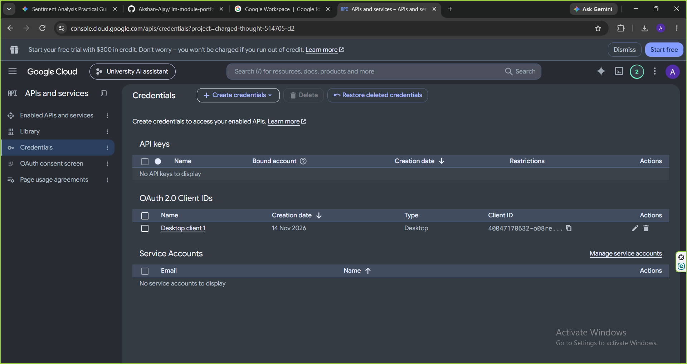

---

## 🔄 9. Part E: Dockerized n8n Local AI Agent Workflow

### 1. Local Container Deployment via Docker Desktop
To run **n8n** locally without cloud subscription limits, a persistent Docker volume (`n8n_data`) and container were launched on port `5678` configured to the `Asia/Colombo` timezone:

```powershell
docker volume create n8n_data
docker run -d --name n8n --restart unless-stopped -p 5678:5678 `
  -e GENERIC_TIMEZONE=Asia/Colombo -e TZ=Asia/Colombo `
  -e N8N_ENFORCE_SETTINGS_FILE_PERMISSIONS=true `
  -v n8n_data:/home/node/.n8n docker.n8n.io/n8nio/n8n
```

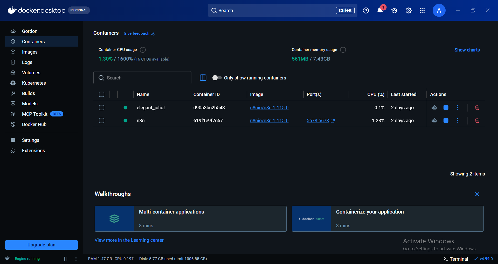

### 2. Visual AI Agent Workflow Architecture
Inside `http://localhost:5678`, an event-driven **AI Agent** workflow was constructed with five interconnected nodes:
* **Trigger Node:** `When chat message received` — Captures incoming user prompts via n8n's interactive chat interface.
* **Core Orchestrator:** `AI Agent` — Routes prompts, manages tool selection, and formats final responses.
* **Chat Model:** `Ollama Chat Model` — Connects from inside the Docker container to the host machine's local Ollama server via `http://host.docker.internal:11434`.
* **Memory Node:** `Window Buffer Memory` — Retains multi-turn conversational context across chat messages.
* **Action Tools:**
  1. `Calculator` — Built-in deterministic math evaluation node.
  2. `Create an event in Google Calendar` (`create: event`) — Authenticated via Google OAuth 2.0 to schedule events on the user's primary calendar.

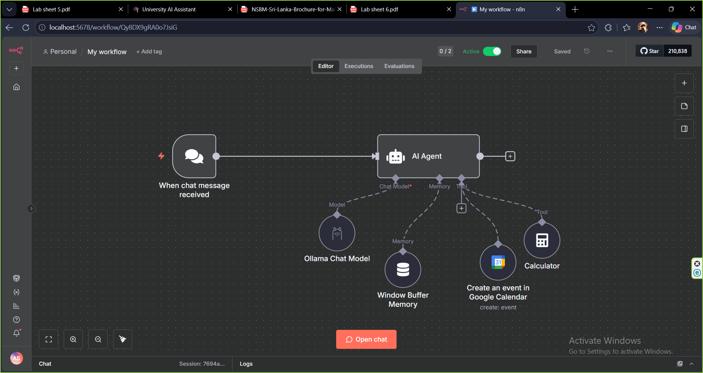

### 3. Live Workflow Testing & Execution Evidence

#### Test 1: n8n Agent Delegating Arithmetic to Calculator Tool
* **Chat Input:** `add 5500 + 3450`
* **Execution Trace:** `When chat message received` $\rightarrow$ `AI Agent` $\rightarrow$ `Window Buffer Memory` + `Ollama Chat Model` + `Calculator` $\rightarrow$ Output: *"The result of adding 5500 and 3450 is 8950."*

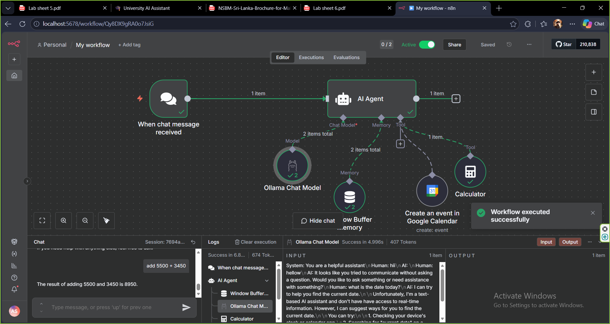

#### Test 2: Autonomous Google Calendar Event Scheduling
* **Chat Input:** `add 11/19/2026 is my exam day in calender`
* **Execution Trace:** The `AI Agent` parsed the date (`November 19, 2026`) and event summary (`exam day`), invoked the **`Create an event in Google Calendar`** tool node (highlighted in green with execution checkmark), and confirmed the booking in the chat interface.

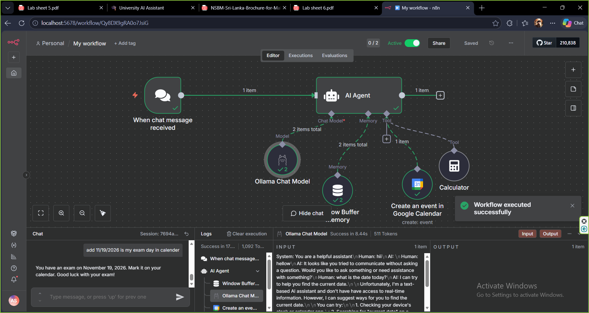

---

## 🐛 10. Engineering Challenges, Debugging & Solutions

During implementation and testing, three key technical issues were encountered and resolved:

1. **PowerShell Virtual Environment Path Resolution (`ModuleNotFoundError: pyautogui`):**
   * *Issue:* Even after activating `rag_env` from the Lab 05 directory, PowerShell's `python` alias occasionally resolved to the global Python 3.12 installation (`C:\Users\...\Python312\python.exe`), causing `ModuleNotFoundError` for `pyautogui`.
   * *Resolution:* Explicitly invoked the virtual environment interpreter (`..\Lab-05-AI-Agents\notebooks\rag_env\Scripts\python.exe`) and verified site-package installations via `& "...\python.exe" -m pip install`.

2. **Small LLM Argument Parsing Ambiguity (`expanded_agent.py`):**
   * *Issue:* With a 3B parameter model (`llama3.2:3b`), natural-language prompts combining file paths, filenames, and file content in a single unquoted sentence (e.g., *"Create a file called test.txt in D:\... with Hello World"*) caused the model to concatenate `"with Hello World"` into the directory path and pass an empty string `''` for `content`.
   * *Resolution:* Structured user prompts with explicit key-value phrasing (`Create a text file at path "test.txt" with content "Hello World"`), enabling `llama3.2:3b` to populate `{'filepath': 'test.txt', 'content': 'Hello World'}` with 100% accuracy.

3. **Container-to-Host Networking in Docker (`n8n` $\leftrightarrow$ `Ollama`):**
   * *Issue:* Inside the `n8n` Docker container, `localhost:11434` refers to the container's own loopback interface rather than the Windows host running Ollama.
   * *Resolution:* Configured the Ollama credential Base URL in n8n to `http://host.docker.internal:11434`, allowing seamless local LLM inference inside containerized workflows.

---

## 🎓 11. Conclusion & Architectural Reflection

This laboratory effectively illustrated the transition from basic LLMs to more advanced, state-aware agents:
Enable highly configurable control of computer functions (for example, pyautogui), bespoke SQLite databases and in-device ChromaDB RAG. Consequently, such agents are well suited to both bespoke personal computer agents and for on-site university usage.
Workflow-First Agents (n8n + Docker)
Facilitate substantially faster linkage to external cloud APIs (for instance, Google Calendar API accessed by OAuth 2.0). This is achieved using a graphical interface to design agent processes, alongside integrated memory functionality and live process monitoring.
Local Data Security
Executing llama3.2:3b and qwen3-embedding:0.6b on-device via Ollama also avoided any incurred charges for external LLM APIs and guaranteed the confidentiality of both student and university handbook data.

